# Laboratory Work No. 6 — Kassymzhanov Arzum

IT1-2404IS · Variant 12

## 1. Aim and project baseline

The aim of this work is to implement book form processing with Spring MVC and Thymeleaf: field binding, declarative validation, preservation of submitted values after errors, internationalization and centralized exception handling. The individual assignment is Variant 12: method validation of a search request parameter.

Student: Kassymzhanov Arzum. Group: IT1-2404IS. Course: RWPSF 3305 — Web Application Development with Spring Framework. Laboratory Work No. 6: Forms and validation.

Repository and branch: https://github.com/Karz317/spring-lab-01/tree/lab06

The baseline is branch lab04, commit bfaaf1278571960107ff2940e7cb27d4bb328b31. The available repository did not contain the catalogue from Laboratory Work No. 5, so Book, BookRepository, BookService, REST CRUD operations, catalogue pages, an author filter, CSS and a welcome page were added. The existing code from laboratory works 2–4 was preserved. Implementation commit for Laboratory Work No. 6: ec47757.

| Component | Actual configuration |
| --- | --- |
| Java | JDK 25.0.4.1 LTS; archive SHA-256 verified |
| Spring Boot | 4.1.1 |
| Maven | 3.9.16, repository wrapper |
| Views | Thymeleaf; English and Russian resource bundles |
| Validation | Jakarta Bean Validation, Hibernate Validator |
| Storage | ConcurrentHashMap; three initial books; in-memory data |
| Verification | 32 automated tests; 23 browser/HTTP check records |

## 2. Form object and validation rules

BookForm is separate from the immutable Book record. Getters and setters allow WebDataBinder to populate the object partially and redisplay it together with BindingResult. Users cannot bind an id through the form: @InitBinder allows only title, author, year, genre and available. Unlike the primitive int in the handout, the year uses Integer with @NotNull: an empty input receives the message “The year is required” rather than becoming 0.

| Field | Constraint | Behavior |
| --- | --- | --- |
| title | @NotBlank, @Size(max=120) | An empty string, whitespace-only input and 121 characters are rejected |
| author | @NotBlank, @NoDigits | The name is required; digits, including Unicode digits, are forbidden |
| year | @NotNull, @Min(1450), @Max(2100) | 1450 and 2100 are accepted; empty and nonnumeric values are rejected |
| genre | @NotNull | A genre must be selected; an unknown enum value produces a binding error |
| available | boolean | The checkbox value is persisted in Book |

### Listing 1. BookForm

src/main/java/kz/iitu/springlab/web/BookForm.java

```java
package kz.iitu.springlab.web;

import jakarta.validation.constraints.Max;
import jakarta.validation.constraints.Min;
import jakarta.validation.constraints.NotBlank;
import jakarta.validation.constraints.NotNull;
import jakarta.validation.constraints.Size;
import kz.iitu.springlab.web.validation.NoDigits;

public class BookForm {
    @NotBlank(message = "{book.title.required}")
    @Size(max = 120, message = "{book.title.size}")
    private String title;

    @NotBlank(message = "{book.author.required}")
    @NoDigits
    private String author;

    @NotNull(message = "{book.year.required}")
    @Min(value = 1450, message = "{book.year.range}")
    @Max(value = 2100, message = "{book.year.range}")
    private Integer year;

    @NotNull(message = "{book.genre.required}")
    private Genre genre;

    private boolean available;

    public String getTitle() { return title; }
    public void setTitle(String title) { this.title = title; }
    public String getAuthor() { return author; }
    public void setAuthor(String author) { this.author = author; }
    public Integer getYear() { return year; }
    public void setYear(Integer year) { this.year = year; }
    public Genre getGenre() { return genre; }
    public void setGenre(Genre genre) { this.genre = genre; }
    public boolean isAvailable() { return available; }
    public void setAvailable(boolean available) { this.available = available; }
}
```

### Listing 2. Genre

src/main/java/kz/iitu/springlab/web/Genre.java

```java
package kz.iitu.springlab.web;

public enum Genre {
    FICTION, NON_FICTION, SCIENCE, TECHNOLOGY, HISTORY
}
```

### Listing 3. Book

src/main/java/kz/iitu/springlab/catalog/Book.java

```java
package kz.iitu.springlab.catalog;

import kz.iitu.springlab.web.Genre;

public record Book(Long id, String title, String author, int year,
                   Genre genre, boolean available) {
    public Book(Long id, String title, String author, int year) {
        this(id, title, author, year, Genre.TECHNOLOGY, true);
    }
}
```

## 3. Controller and form template

GET /books/new adds a new BookForm and Genre.values() to the model. In the POST handler, BindingResult is placed immediately after @Valid @ModelAttribute("form"). If errors exist, genres is added back to the model and books/form is returned. A valid submission creates a book, adds a localized flash message and returns redirect:/books.

th:object selects the form object; *{title} refers to its property. th:field generates name, id and value, as well as selected or checked states for select and checkbox controls. th:errors displays messages, and th:errorclass highlights the field. The #fields error summary is inside the th:object scope so it can access BindingResult. novalidate makes the server-side validation visible during the demonstration.

### Listing 4. BookPageController: GET, POST and PRG

src/main/java/kz/iitu/springlab/web/BookPageController.java

```java
package kz.iitu.springlab.web;

import jakarta.validation.Valid;
import java.util.Locale;
import kz.iitu.springlab.catalog.Book;
import kz.iitu.springlab.catalog.BookService;
import org.springframework.context.MessageSource;
import org.springframework.stereotype.Controller;
import org.springframework.ui.Model;
import org.springframework.validation.BindingResult;
import org.springframework.web.bind.WebDataBinder;
import org.springframework.web.bind.annotation.*;
import org.springframework.web.servlet.mvc.support.RedirectAttributes;

@Controller
@RequestMapping("/books")
public class BookPageController {
    private final BookService service;
    private final MessageSource messages;

    public BookPageController(BookService service, MessageSource messages) {
        this.service = service;
        this.messages = messages;
    }

    @InitBinder("form")
    public void configureBinding(WebDataBinder binder) {
        binder.setAllowedFields("title", "author", "year", "genre", "available");
    }

    @GetMapping
    public String list(@RequestParam(required = false) String author, Model model) {
        model.addAttribute("books", service.findAll(author));
        model.addAttribute("author", author);
        return "books/list";
    }

    @GetMapping("/new")
    public String newForm(Model model) {
        model.addAttribute("form", new BookForm());
        model.addAttribute("genres", Genre.values());
        return "books/form";
    }

    @GetMapping("/{id}")
    public String detail(@PathVariable long id, Model model) {
        model.addAttribute("book", service.findById(id));
        return "books/detail";
    }

    @PostMapping
    public String create(@Valid @ModelAttribute("form") BookForm form,
                         BindingResult binding, Model model,
                         RedirectAttributes redirect, Locale locale) {
        if (binding.hasErrors()) {
            model.addAttribute("genres", Genre.values());
            return "books/form";
        }
        Book saved = service.create(new Book(null, form.getTitle(), form.getAuthor(),
                form.getYear(), form.getGenre(), form.isAvailable()));
        redirect.addFlashAttribute("message", messages.getMessage("book.added",
                new Object[]{saved.title()}, locale));
        return "redirect:/books";
    }
}
```

### Listing 5. templates/books/form.html

src/main/resources/templates/books/form.html

```html
<!DOCTYPE html>
<html xmlns:th="http://www.thymeleaf.org" th:lang="${#locale.language}">
<head>
    <meta charset="UTF-8">
    <meta name="viewport" content="width=device-width, initial-scale=1">
    <title th:text="#{book.new}">New book</title>
    <link rel="stylesheet" th:href="@{/css/app.css}">
</head>
<body>
<main class="container narrow">
    <header>
        <a class="brand" th:href="@{/books}" th:text="#{book.catalogue}">Book catalogue</a>
        <nav th:aria-label="#{form.language}">
            <a th:href="@{/books/new(lang='en')}">English</a>
            <a th:href="@{/books/new(lang='ru')}">Русский</a>
        </nav>
    </header>
    <h1 th:text="#{book.new}">New book</h1>
    <p class="intro" th:text="#{form.intro}">Add a book to the catalogue.</p>
    <form class="panel book-form" th:action="@{/books}" th:object="${form}" method="post" novalidate>
        <div class="alert" role="alert" th:if="${#fields.hasAnyErrors()}">
            <strong th:text="#{form.errors}">Please correct the following errors:</strong>
            <ul><li th:each="error : ${#fields.allErrors()}" th:text="${error}"></li></ul>
        </div>
        <div class="field">
            <label for="title" th:text="#{book.title}">Title</label>
            <input type="text" th:field="*{title}" th:errorclass="is-invalid" aria-describedby="title-error">
            <span id="title-error" class="error" th:if="${#fields.hasErrors('title')}" th:errors="*{title}"></span>
        </div>
        <div class="field">
            <label for="author" th:text="#{book.author}">Author</label>
            <input type="text" th:field="*{author}" th:errorclass="is-invalid" aria-describedby="author-error">
            <span id="author-error" class="error" th:if="${#fields.hasErrors('author')}" th:errors="*{author}"></span>
        </div>
        <div class="columns">
            <div class="field">
                <label for="year" th:text="#{book.year}">Year</label>
                <input type="number" th:field="*{year}" th:errorclass="is-invalid" aria-describedby="year-error">
                <span id="year-error" class="error" th:if="${#fields.hasErrors('year')}" th:errors="*{year}"></span>
            </div>
            <div class="field">
                <label for="genre" th:text="#{book.genre}">Genre</label>
                <select th:field="*{genre}" th:errorclass="is-invalid" aria-describedby="genre-error">
                    <option value="" th:text="#{book.genre.choose}">Choose a genre</option>
                    <option th:each="g : ${genres}" th:value="${g}" th:text="#{'genre.' + ${g}}"></option>
                </select>
                <span id="genre-error" class="error" th:if="${#fields.hasErrors('genre')}" th:errors="*{genre}"></span>
            </div>
        </div>
        <label class="checkbox-row">
            <input type="checkbox" th:field="*{available}">
            <span th:text="#{book.available}">Available</span>
        </label>
        <div class="actions">
            <button type="submit" th:text="#{form.submit}">Save</button>
            <a th:href="@{/books}" th:text="#{form.back}">Back to catalogue</a>
        </div>
    </form>
</main>
</body>
</html>
```

## 4. Form checks and Post/Redirect/Get

| Input / action | Observed result |
| --- | --- |
| Empty title; other fields completed | 200 HTML; title error; author, year, genre and checkbox preserved; no new book created |
| Year 1200 | 200 HTML; book.year.range beside the field and in the summary; 1200 remains in the input |
| No genre selected | 200 HTML; book.genre.required; other values remain |
| Author Bloch 2018 | 200 HTML; the custom @NoDigits constraint rejects the value |
| Empty title + year 1200 + no genre | All three errors appear together in the summary |
| Valid form | POST /books → 302 Location: /books → GET /books → 200; a new book and flash message |
| Page refresh | Another GET returns 200; the flash message disappears; the book count remains 4 |

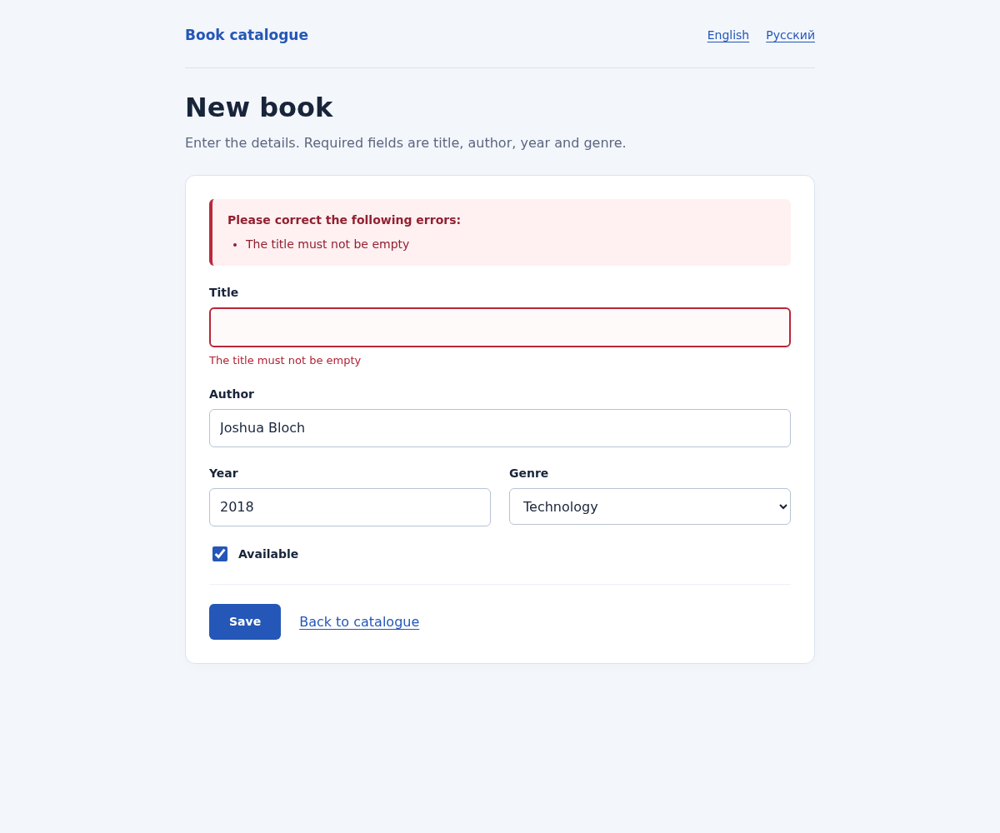

Figure 1. An empty title is rejected; Joshua Bloch, 2018 and Technology are preserved.

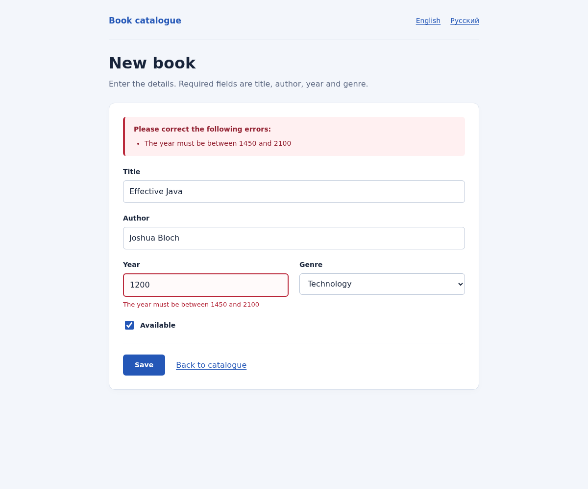

Figure 2. Year 1200 is rejected; the invalid value remains visible in the field.

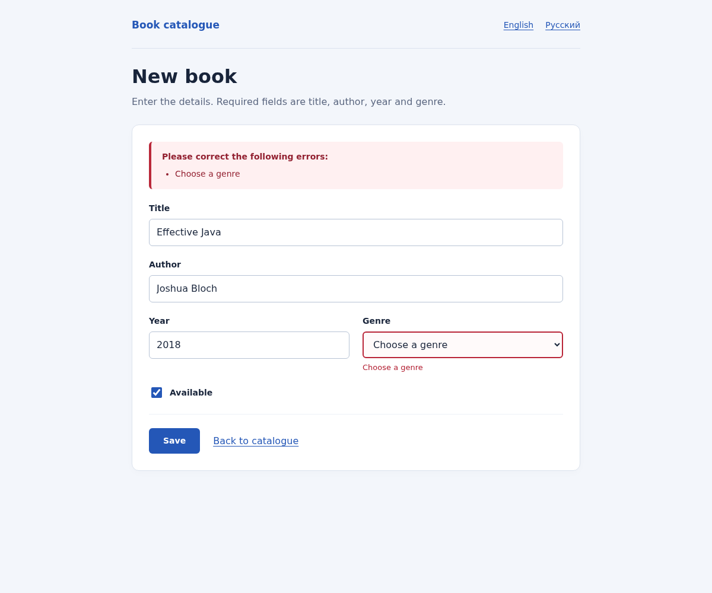

Figure 3. A genre is required; the other submitted fields are preserved.

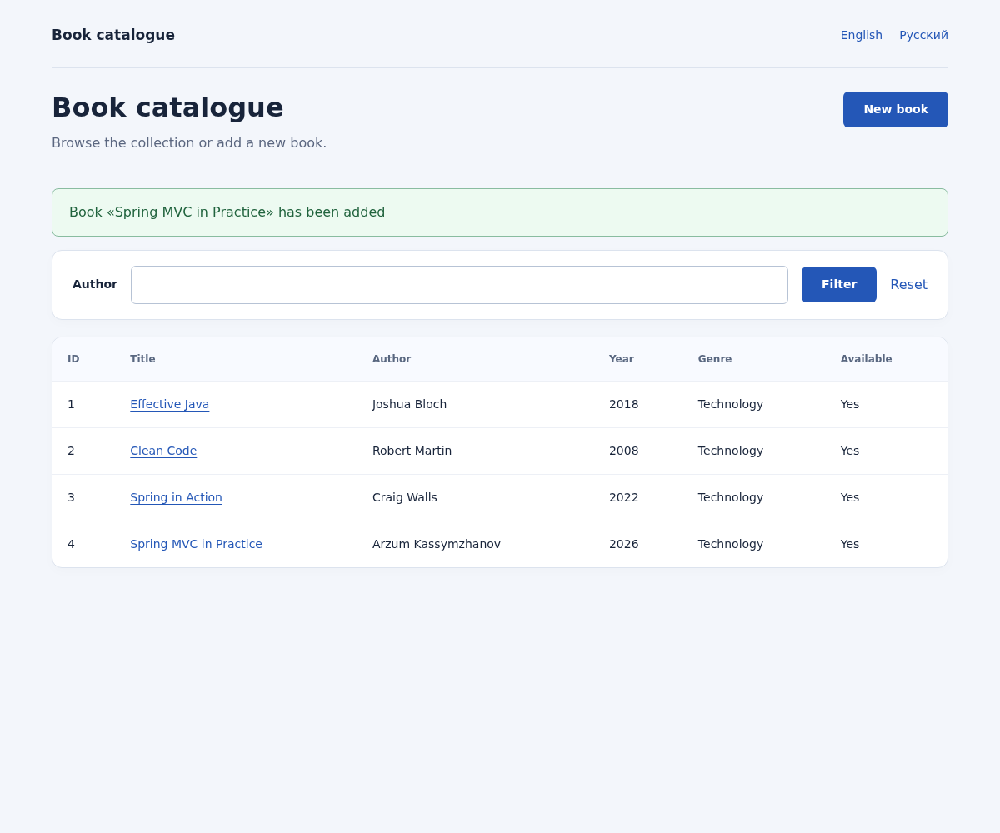

Figure 4. Successful POST: the redirect shows the new book and a flash message.

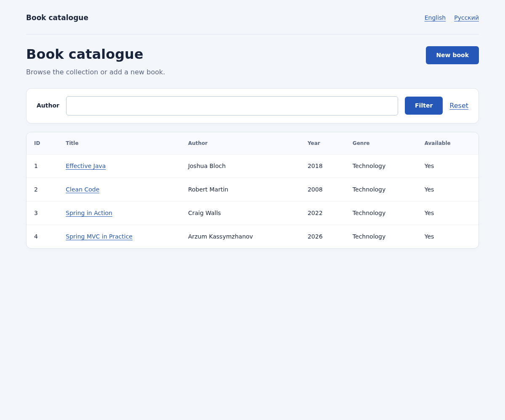

Figure 5. After refresh, the flash message is absent and the catalogue still contains four books.

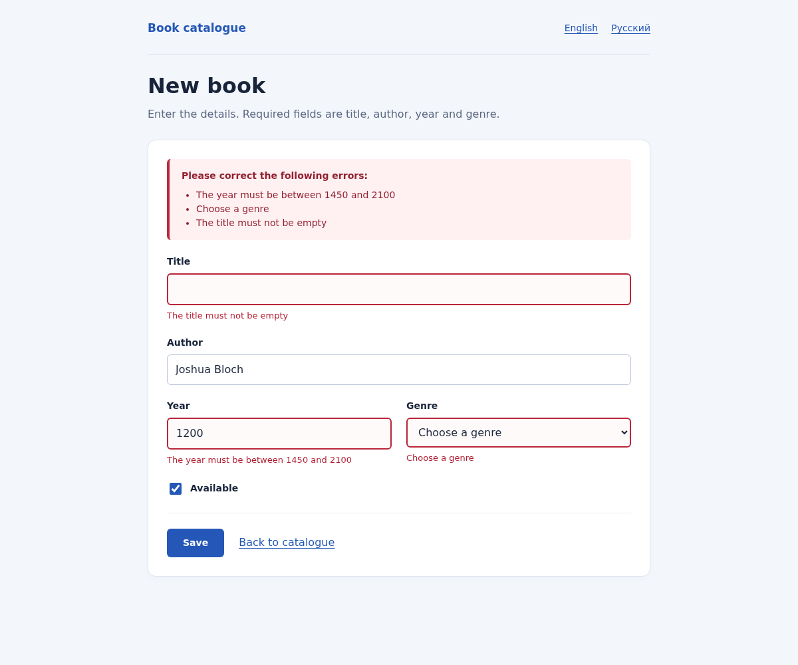

Figure 6. The error summary lists several violations simultaneously.

FlashMap stores the message between the POST and the following GET, normally through the HTTP session. The matching GET consumes it. Pressing F5 repeats the GET and does not invoke service.create again.

## 5. Interface and message internationalization

SessionLocaleResolver defaults to English and stores the selected locale in the session. LocaleChangeInterceptor reads lang. Labels, genre names, Bean Validation messages, type-conversion errors, flash messages and the 404 page use resource bundles. The mandatory messages.properties enables Spring Boot to configure MessageSource; messages_ru.properties contains the Russian translations. The following screenshots show the same title error in both languages. Russian text is retained in the localization screenshots and source bundle as evidence of the required second language.


Figure 7. English labels and the validation message “The title must not be empty”.

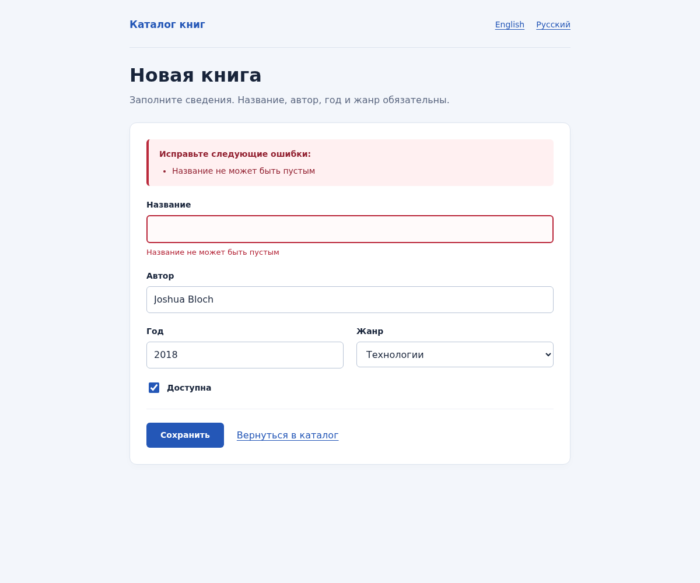

Figure 8. Russian labels, genre name and validation message for the same empty-title error.

### Listing 6. LocaleConfiguration

src/main/java/kz/iitu/springlab/config/LocaleConfiguration.java

```java
package kz.iitu.springlab.config;

import java.util.Locale;
import org.springframework.context.annotation.Bean;
import org.springframework.context.annotation.Configuration;
import org.springframework.web.servlet.LocaleResolver;
import org.springframework.web.servlet.config.annotation.InterceptorRegistry;
import org.springframework.web.servlet.config.annotation.WebMvcConfigurer;
import org.springframework.web.servlet.i18n.LocaleChangeInterceptor;
import org.springframework.web.servlet.i18n.SessionLocaleResolver;

@Configuration
public class LocaleConfiguration implements WebMvcConfigurer {
    @Bean
    public LocaleResolver localeResolver() {
        SessionLocaleResolver resolver = new SessionLocaleResolver();
        resolver.setDefaultLocale(Locale.ENGLISH);
        return resolver;
    }

    @Bean
    public LocaleChangeInterceptor localeChangeInterceptor() {
        LocaleChangeInterceptor interceptor = new LocaleChangeInterceptor();
        interceptor.setParamName("lang");
        interceptor.setIgnoreInvalidLocale(true);
        return interceptor;
    }

    @Override
    public void addInterceptors(InterceptorRegistry registry) {
        registry.addInterceptor(localeChangeInterceptor());
    }
}
```

### Listing 7. messages.properties — complete default bundle

src/main/resources/messages.properties

```properties
book.catalogue=Book catalogue
book.new=New book
book.id=ID
book.title=Title
book.author=Author
book.year=Year
book.genre=Genre
book.genre.choose=Choose a genre
book.available=Available
book.added=Book «{0}» has been added
book.title.required=The title must not be empty
book.title.size=The title must not exceed 120 characters
book.author.required=The author must not be empty
book.author.nodigits=The author must not contain digits
book.year.required=The year is required
book.year.range=The year must be between 1450 and 2100
book.genre.required=Choose a genre
book.notfound=Book with id {0} was not found
book.search.size=The search query must contain between 2 and 60 characters
form.submit=Save
form.back=Back to catalogue
form.language=Language
form.intro=Enter the details. Required fields are title, author, year and genre.
form.errors=Please correct the following errors:
catalogue.intro=Browse the collection or add a new book.
catalogue.filter=Filter
catalogue.reset=Reset
catalogue.empty=No books found
genre.FICTION=Fiction
genre.NON_FICTION=Non-fiction
genre.SCIENCE=Science
genre.TECHNOLOGY=Technology
genre.HISTORY=History
genre.UNKNOWN=Not specified
common.yes=Yes
common.no=No
error.notfound=Book not found
error.validation=Validation failed
typeMismatch.form.year=Enter a whole number for the year
typeMismatch.form.genre=Choose a genre from the list
```

### Listing 8. messages_ru.properties — complete Russian bundle

src/main/resources/messages_ru.properties

```properties
book.catalogue=Каталог книг
book.new=Новая книга
book.id=№
book.title=Название
book.author=Автор
book.year=Год
book.genre=Жанр
book.genre.choose=Выберите жанр
book.available=Доступна
book.added=Книга «{0}» добавлена
book.title.required=Название не может быть пустым
book.title.size=Название не длиннее 120 символов
book.author.required=Автор не может быть пустым
book.author.nodigits=Имя автора не должно содержать цифры
book.year.required=Укажите год
book.year.range=Год должен быть в диапазоне 1450–2100
book.genre.required=Выберите жанр
book.notfound=Книга с номером {0} не найдена
book.search.size=Поисковый запрос должен содержать от 2 до 60 символов
form.submit=Сохранить
form.back=Вернуться в каталог
form.language=Язык
form.intro=Заполните сведения. Название, автор, год и жанр обязательны.
form.errors=Исправьте следующие ошибки:
catalogue.intro=Просматривайте коллекцию и добавляйте новые книги.
catalogue.filter=Фильтр
catalogue.reset=Сбросить
catalogue.empty=Книги не найдены
genre.FICTION=Художественная литература
genre.NON_FICTION=Документальная литература
genre.SCIENCE=Наука
genre.TECHNOLOGY=Технологии
genre.HISTORY=История
genre.UNKNOWN=Не указан
common.yes=Да
common.no=Нет
error.notfound=Книга не найдена
error.validation=Ошибка валидации
typeMismatch.form.year=Введите целое число в поле года
typeMismatch.form.genre=Выберите жанр из списка
```

## 6. Custom constraint @NoDigits

@NoDigits defines the mandatory message, groups and payload members, runtime retention and the link to NoDigitsValidator. A null value passes because @NotBlank handles a missing author. codePoints(), unlike chars(), also recognizes digits in supplementary Unicode planes. Tests cover ordinary digits, the Arabic digit ٢ and the mathematical digit 𝟙.

### Listing 9. The @NoDigits annotation

src/main/java/kz/iitu/springlab/web/validation/NoDigits.java

```java
package kz.iitu.springlab.web.validation;

import jakarta.validation.Constraint;
import jakarta.validation.Payload;
import java.lang.annotation.ElementType;
import java.lang.annotation.Retention;
import java.lang.annotation.RetentionPolicy;
import java.lang.annotation.Target;

@Target(ElementType.FIELD)
@Retention(RetentionPolicy.RUNTIME)
@Constraint(validatedBy = NoDigitsValidator.class)
public @interface NoDigits {
    String message() default "{book.author.nodigits}";
    Class<?>[] groups() default {};
    Class<? extends Payload>[] payload() default {};
}
```

### Listing 10. NoDigitsValidator

src/main/java/kz/iitu/springlab/web/validation/NoDigitsValidator.java

```java
package kz.iitu.springlab.web.validation;

import jakarta.validation.ConstraintValidator;
import jakarta.validation.ConstraintValidatorContext;

public class NoDigitsValidator implements ConstraintValidator<NoDigits, String> {
    @Override
    public boolean isValid(String value, ConstraintValidatorContext context) {
        return value == null || value.codePoints().noneMatch(Character::isDigit);
    }
}
```

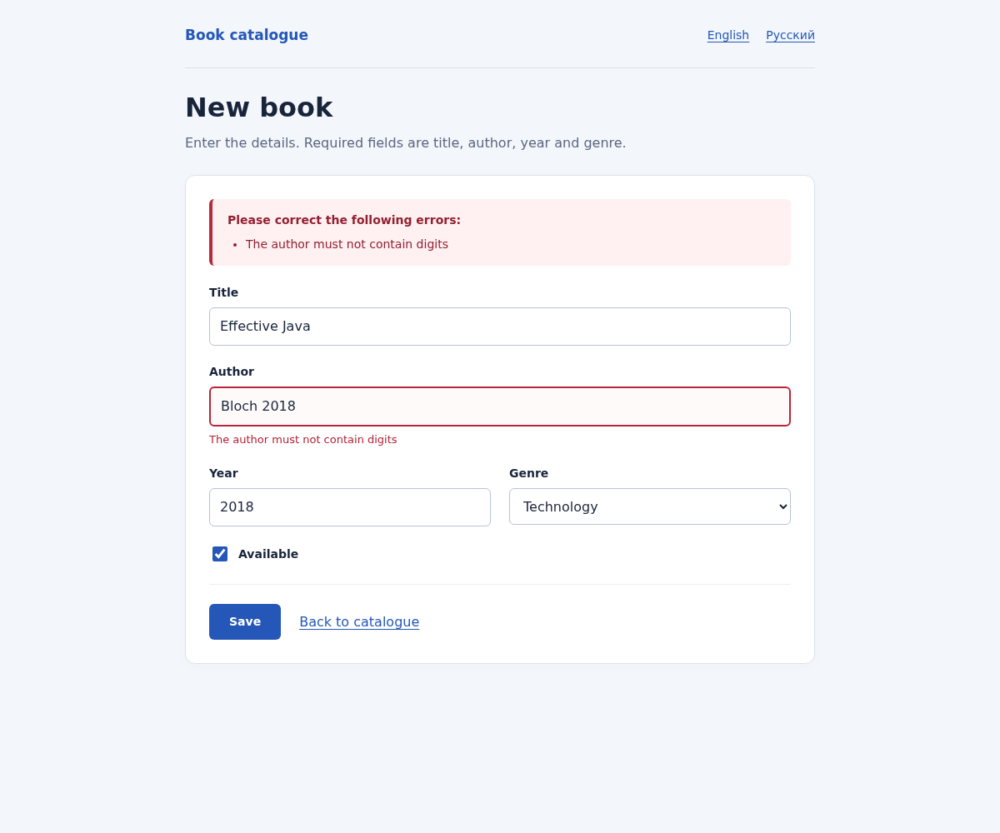

Figure 9. The custom constraint rejects the author value Bloch 2018.

## 7. Centralized exception handling

BookService throws BookNotFoundException when an identifier is missing. Each advice is scoped to a specific controller through assignableTypes. This avoids overlap between MVC and REST, since @RestController is also a @Controller. The page handler explicitly declares @ResponseStatus(NOT_FOUND); returning only a template name would otherwise produce status 200. The API returns an RFC 9457 ProblemDetail.

| Request | Observed status / Content-Type | Handler |
| --- | --- | --- |
| GET /books/999?lang=en | 404 · text/html;charset=UTF-8 | PageExceptionHandler → error/not-found |
| GET /api/books/999?lang=en | 404 · application/problem+json | ApiExceptionHandler → ProblemDetail |

```json
{
  "detail": "Book with id 999 was not found",
  "instance": "/api/books/999",
  "status": 404,
  "title": "Book not found"
}
```

### Listing 11. BookNotFoundException

src/main/java/kz/iitu/springlab/catalog/BookNotFoundException.java

```java
package kz.iitu.springlab.catalog;

public class BookNotFoundException extends RuntimeException {
    private final long id;

    public BookNotFoundException(long id) {
        super("Book with id " + id + " was not found");
        this.id = id;
    }

    public long getId() {
        return id;
    }
}
```

### Listing 12. PageExceptionHandler

src/main/java/kz/iitu/springlab/web/PageExceptionHandler.java

```java
package kz.iitu.springlab.web;

import java.util.Locale;
import kz.iitu.springlab.catalog.BookNotFoundException;
import org.springframework.context.MessageSource;
import org.springframework.http.HttpStatus;
import org.springframework.ui.Model;
import org.springframework.web.bind.annotation.*;

@ControllerAdvice(assignableTypes = BookPageController.class)
public class PageExceptionHandler {
    private final MessageSource messages;

    public PageExceptionHandler(MessageSource messages) {
        this.messages = messages;
    }

    @ExceptionHandler(BookNotFoundException.class)
    @ResponseStatus(HttpStatus.NOT_FOUND)
    public String handleNotFound(BookNotFoundException exception, Model model, Locale locale) {
        model.addAttribute("message", messages.getMessage("book.notfound",
                new Object[]{exception.getId()}, locale));
        return "error/not-found";
    }
}
```

### Listing 13. ApiExceptionHandler

src/main/java/kz/iitu/springlab/web/ApiExceptionHandler.java

```java
package kz.iitu.springlab.web;

import java.util.Locale;
import java.util.Map;
import kz.iitu.springlab.catalog.BookNotFoundException;
import org.slf4j.Logger;
import org.slf4j.LoggerFactory;
import org.springframework.context.MessageSource;
import org.springframework.http.HttpStatus;
import org.springframework.http.ProblemDetail;
import org.springframework.web.bind.annotation.*;
import org.springframework.web.method.annotation.HandlerMethodValidationException;

@RestControllerAdvice(assignableTypes = BookRestController.class)
public class ApiExceptionHandler {
    private static final Logger log = LoggerFactory.getLogger(ApiExceptionHandler.class);
    private final MessageSource messages;

    public ApiExceptionHandler(MessageSource messages) {
        this.messages = messages;
    }

    @ExceptionHandler(BookNotFoundException.class)
    @ResponseStatus(HttpStatus.NOT_FOUND)
    public ProblemDetail handleNotFound(BookNotFoundException exception, Locale locale) {
        ProblemDetail problem = ProblemDetail.forStatusAndDetail(HttpStatus.NOT_FOUND,
                messages.getMessage("book.notfound", new Object[]{exception.getId()}, locale));
        problem.setTitle(messages.getMessage("error.notfound", null, locale));
        return problem;
    }

    @ExceptionHandler(HandlerMethodValidationException.class)
    @ResponseStatus(HttpStatus.BAD_REQUEST)
    public ProblemDetail handleMethodValidation(HandlerMethodValidationException exception,
                                               Locale locale) {
        log.info("Handled {} in book search", exception.getClass().getSimpleName());
        ProblemDetail problem = ProblemDetail.forStatusAndDetail(HttpStatus.BAD_REQUEST,
                messages.getMessage("book.search.size", null, locale));
        problem.setTitle(messages.getMessage("error.validation", null, locale));
        problem.setProperty("exception", exception.getClass().getSimpleName());
        problem.setProperty("errors", exception.getParameterValidationResults().stream()
                .flatMap(result -> result.getResolvableErrors().stream().map(error -> Map.of(
                        "parameter", result.getMethodParameter().getParameterName(),
                        "message", messages.getMessage(error, locale))))
                .toList());
        return problem;
    }
}
```


Figure 10. MVC returns the custom HTML 404 page.

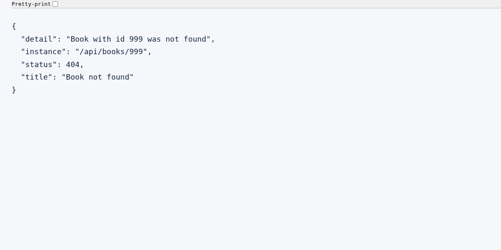

Figure 11. REST returns the actual JSON ProblemDetail. Only JSON whitespace and indentation were formatted for readability.

## 8. Individual assignment — Variant 12

Assignment: place @Size directly on a @RequestParam of the search endpoint, demonstrate the resulting exception and handle it. The implementation provides GET /api/books/search?q=…. The query must contain 2–60 characters inclusive, and title matching is case-insensitive. A missing q defaults to an empty string and is rejected. A valid query without matching books returns 200 and [].

Spring MVC built-in method validation checks the parameter before invoking search and throws HandlerMethodValidationException when the constraint is violated. The controller has no class-level @Validated, which would select a different AOP validation path. The handler returns 400 application/problem+json with localized text, the actual exception name and errors identifying parameter q. The exception type is also written to the application log.

### Listing 14. BookRestController, including the Variant 12 search endpoint

src/main/java/kz/iitu/springlab/web/BookRestController.java

```java
package kz.iitu.springlab.web;

import jakarta.validation.constraints.Size;
import java.net.URI;
import java.util.List;
import kz.iitu.springlab.catalog.Book;
import kz.iitu.springlab.catalog.BookService;
import org.springframework.http.ResponseEntity;
import org.springframework.web.bind.annotation.*;
import org.springframework.web.server.ResponseStatusException;
import org.springframework.http.HttpStatus;

@RestController
@RequestMapping("/api/books")
public class BookRestController {
    private final BookService service;

    public BookRestController(BookService service) {
        this.service = service;
    }

    @GetMapping
    public List<Book> list(@RequestParam(required = false) String author,
                           @RequestParam(defaultValue = "10") int limit) {
        if (limit < 0) {
            throw new ResponseStatusException(HttpStatus.BAD_REQUEST, "limit must not be negative");
        }
        return service.findAll(author).stream().limit(limit).toList();
    }

    // Spring MVC performs method validation; class-level @Validated is intentionally absent.
    @GetMapping("/search")
    public List<Book> search(@RequestParam(defaultValue = "")
                            @Size(min = 2, max = 60, message = "{book.search.size}") String q) {
        return service.search(q);
    }

    @GetMapping("/{id}")
    public ResponseEntity<Book> find(@PathVariable long id) {
        return ResponseEntity.ok(service.findById(id));
    }

    @PostMapping
    public ResponseEntity<Book> create(@RequestBody BookRequest book) {
        Book saved = service.create(book.toBook());
        return ResponseEntity.created(URI.create("/api/books/" + saved.id())).body(saved);
    }

    @PutMapping("/{id}")
    public ResponseEntity<Book> replace(@PathVariable long id, @RequestBody BookRequest book) {
        return ResponseEntity.ok(service.replace(id, book.toBook()));
    }

    @DeleteMapping("/{id}")
    public ResponseEntity<Void> delete(@PathVariable long id) {
        service.delete(id);
        return ResponseEntity.noContent().build();
    }
}
```

| Request / length | Result |
| --- | --- |
| q=Java | 200, Effective Java |
| q=eFfEcTiVe | 200, case-insensitive matching |
| Missing q / 0 | 400 HandlerMethodValidationException |
| q=a / 1 | 400 HandlerMethodValidationException |
| q=xx / 2 | 200 [] |
| 60 x characters | 200 [] |
| 61 x characters | 400 HandlerMethodValidationException |
| q=a&lang=ru | 400, Russian text in detail and errors |

```json
{
  "detail": "The search query must contain between 2 and 60 characters",
  "instance": "/api/books/search",
  "status": 400,
  "title": "Validation failed",
  "exception": "HandlerMethodValidationException",
  "errors": [
    {
      "parameter": "q",
      "message": "The search query must contain between 2 and 60 characters"
    }
  ]
}
```

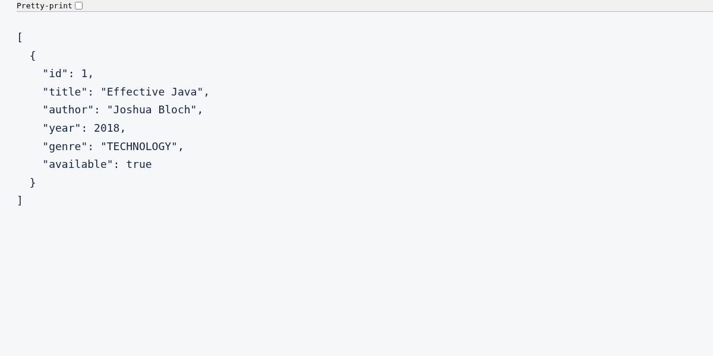

Figure 12. A valid q=Java request returns the matching book.

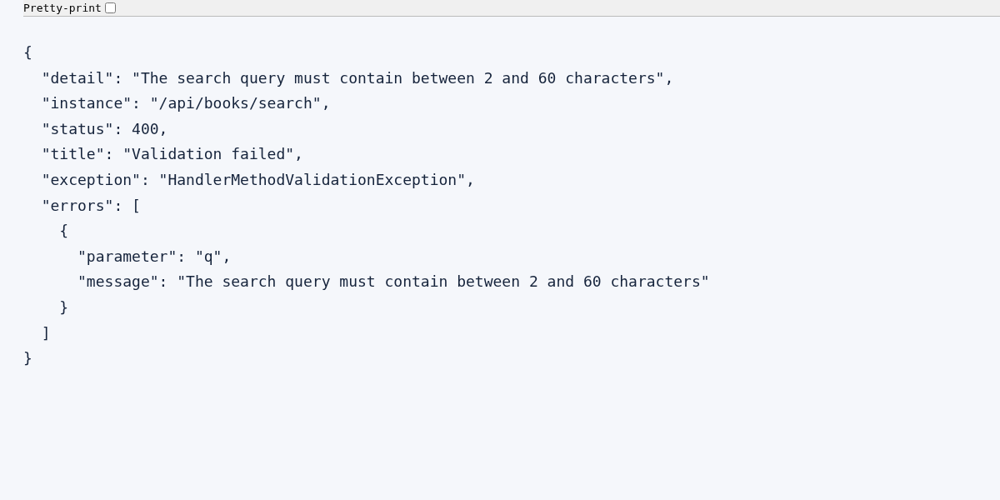

Figure 13. q=a produces 400 and HandlerMethodValidationException in the handled response.

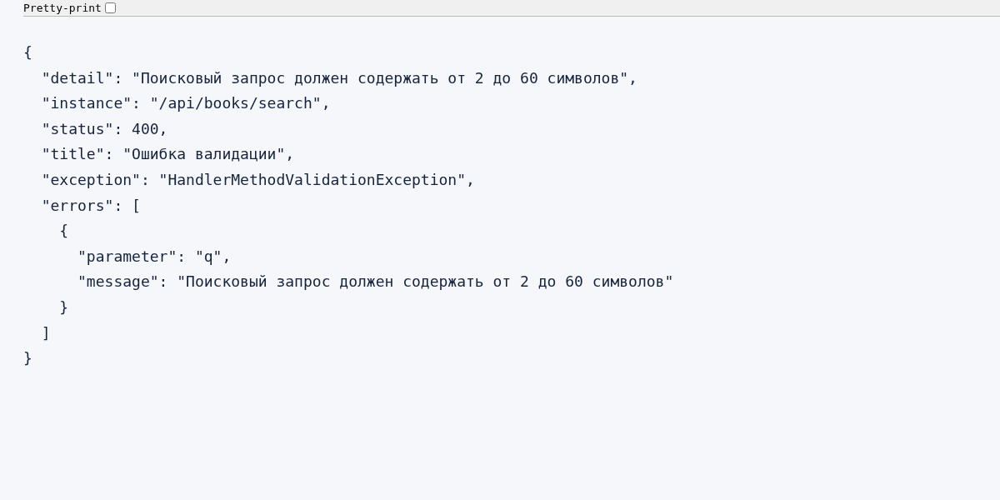

Figure 14. The same method validation error is localized into Russian.

## 9. Verification of the Laboratory Work No. 5 baseline

REST accepts a separate BookRequest. Genre and availability are optional in the original JSON request, so the commands from Laboratory Work No. 5 remain compatible. The repository assigns identifiers, PUT uses the id from the URL, and deleting an already deleted resource returns 404.

| Operation | Verified result |
| --- | --- |
| GET /api/books?author=Bloch&limit=1 | 200, JSON includes Joshua Bloch |
| GET /api/books/{id} | 200 for an existing record; 404 ProblemDetail for a missing record |
| POST /api/books | 201 + Location; the created resource can be read at Location |
| PUT /api/books/{id} | 200 with the replaced record; 404 for a missing record |
| DELETE /api/books/{id} | 204 with an empty body; a second DELETE returns 404 |

| Experiment | Status | Explanation |
| --- | --- | --- |
| GET /api/books/abc | 400 | abc cannot be converted to the long @PathVariable |
| GET /api/nothing | 404 | No matching route or static resource exists |
| DELETE /api/books | 405 | DELETE is not mapped to the collection path without an id |
| POST /api/books, Content-Type: text/plain | 415 | No suitable converter can read BookRequest from text/plain |
| GET /api/books, Accept: application/xml | 406 | The available converters cannot write the response in the requested representation |


Figure 15. The styled catalogue with the three initial books.

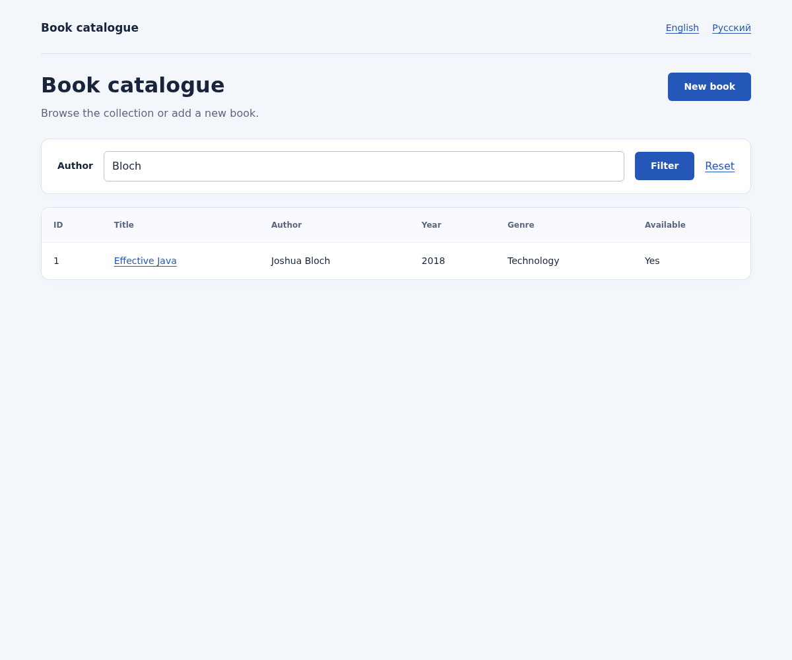

Figure 16. The author=Bloch filter leaves one matching record.

## 10. Automated verification and reproduction

bash mvnw -s /workspace/.tools/maven-settings.xml -B verify was executed with Java 25. It completed with BUILD SUCCESS and produced an executable JAR. After the fixes, the complete suite was rerun and the reusable cloud setup instructions were exercised separately. The server was started from the built JAR; browser checks used real headless Chromium through Playwright.

| Suite | Executed | Failures / Errors / Skipped |
| --- | --- | --- |
| BookWorkflowTests | 25 | 0 / 0 / 0 |
| NoDigitsValidatorTests | 6 | 0 / 0 / 0 |
| SpringLab01ApplicationTests | 1 | 0 / 0 / 0 |
| Total | 32 | 0 / 0 / 0 |

The tests cover rejected submissions without insertion, year and query-length boundaries, invalid enum values, nonnumeric input, Russian locale persistence, one-time flash messages, persistence of genre/available, prevention of client-assigned identifiers, escaping of submitted HTML, REST CRUD and HTTP errors. Browser observations are stored in docs/browser-checks.json, and PNG captures are stored in docs/screenshots. These checks demonstrate the technical implementation; the student must still present and explain the application to the lecturer.

```bash
bash mvnw clean verify
java -jar target/spring-lab-01-0.0.1-SNAPSHOT.jar

# In the prepared cloud environment:
source /workspace/.tools/java-env.sh
bash mvnw -s /workspace/.tools/maven-settings.xml -B verify

# Browser screenshots (Chromium and Playwright):
python scripts/capture-evidence.py
```

The demonstration uses the default profile on port 8080. The existing dev profile uses port 8081. No database or new secrets are required; in-memory data resets when the process restarts. Sending real email is not required for this assignment. Cloud Maven uses the supported proxy and existing system trust store with TLS verification enabled.

Windows working directory: C:\Labworks\Spring\spring-lab-01-main. After obtaining the lab06 files and installing JDK 25, run the PowerShell commands below. Preserve the existing folder and local changes before replacing files. The complete Git project can also be cloned into a new adjacent directory, as documented in README.

```powershell
Set-Location 'C:\Labworks\Spring\spring-lab-01-main'
.\mvnw.cmd clean verify
java -jar .\target\spring-lab-01-0.0.1-SNAPSHOT.jar
```

## 11. Defence questions and answers

### Why is the form object separate from Book?

Input rules and mutable form state are separate from the domain record. The id is excluded from form binding to prevent mass assignment.

### What do th:object and *{title} mean?

th:object selects the form object from the model; *{title} refers to the title property of that object.

### What does th:field generate?

It generates name, id, value, selected/checked states and a hidden marker for checkboxes. On an error, it uses the rejected value from BindingResult.

### Why add an empty object in GET?

The template needs an object to evaluate th:field and to supply initial values before the first POST.

### What happens if @Valid is removed?

Binding and type conversion still occur, but the form constraints are not checked by Bean Validation.

### What if BindingResult is moved after Model?

It is no longer adjacent to the validated object, so Spring cannot associate it correctly. Invalid input may produce an exception instead of the normal error redisplay.

### Why add genres to the model again?

The available options are not submitted with POST or stored in BookForm; every rendering of the form must receive them.

### Where do form errors go?

BindingResult collects FieldError and ObjectError entries. The controller checks hasErrors; this differs from the method validation exception in Variant 12.

### How do NotNull, NotEmpty and NotBlank differ?

NotNull rejects null. NotEmpty also rejects an empty string or collection. NotBlank rejects a string that contains only whitespace.

### Where does an error message come from?

The key in message="{book.title.required}" is resolved by the validator through MessageSource and the active Locale. th:errors renders the resolved text.

### What is a field error versus a global error?

A field error belongs to one property; a global error belongs to the whole object, such as a class-level constraint. The constraints used in this form produce field errors.

### Why is messages.properties mandatory?

It is the default bundle needed for MessageSource auto-configuration and provides fallback text for missing translations.

### How is the language selected?

LocaleChangeInterceptor reads lang. SessionLocaleResolver stores the selection in the HTTP session. The default is English.

### What are the three mandatory constraint members?

message defines the text or bundle key; groups defines validation groups; payload provides additional violation metadata.

### Why does NoDigits accept null?

It checks for digits only. The separate NotBlank constraint enforces a required author.

### How are the advice classes scoped?

They use assignableTypes = BookPageController.class and BookRestController.class. Without scoping, an applicable handler could return the wrong representation.

### Which exception handler is selected?

Within an applicable controller or advice, the more specific matching exception type is preferred. Advice ordering also matters, and local controller handlers are checked before advice handlers.

### Why is th:utext unsafe for user input?

It inserts unescaped HTML and can enable XSS. This implementation uses th:text and the escaped values produced by th:field.

### Which exception is used in Variant 12?

Spring MVC built-in validation raises HandlerMethodValidationException. ApiExceptionHandler converts it to a 400 ProblemDetail with parameter q and a localized message.

## 12. Conclusions

Declarative validation places input rules beside form properties and allows constraints to be reused without manual checks in controller methods. BindingResult associates violations with individual fields while preserving submitted values. Resource bundles separate text from code and switch the interface and validation messages together. Controller advice and method validation provide consistent HTML and REST error responses, while Post/Redirect/Get prevents duplicate creation when a page is refreshed.

## 13. References

Laboratory_work_6_EN.docx — primary assignment, Variant 12 and report requirements.

Laboratory_work_5_EN.docx — REST and MVC catalogue prerequisites.

Spring Framework: https://docs.spring.io/spring-framework/reference/web/webmvc/mvc-controller/ann-validation.html

Spring Boot: https://docs.spring.io/spring-boot/reference/features/internationalization.html

Thymeleaf: https://www.thymeleaf.org/doc/tutorials/3.1/thymeleafspring.html

## Appendix. Repository and service

### Listing 15. BookRepository

src/main/java/kz/iitu/springlab/catalog/BookRepository.java

```java
package kz.iitu.springlab.catalog;

import java.util.Comparator;
import java.util.List;
import java.util.Optional;
import java.util.concurrent.ConcurrentHashMap;
import java.util.concurrent.atomic.AtomicLong;
import org.springframework.stereotype.Repository;

@Repository
public class BookRepository {
    private final ConcurrentHashMap<Long, Book> storage = new ConcurrentHashMap<>();
    private final AtomicLong sequence = new AtomicLong();

    public BookRepository() {
        create(new Book(null, "Effective Java", "Joshua Bloch", 2018));
        create(new Book(null, "Clean Code", "Robert Martin", 2008));
        create(new Book(null, "Spring in Action", "Craig Walls", 2022));
    }

    public List<Book> findAll() {
        return storage.values().stream().sorted(Comparator.comparing(Book::id)).toList();
    }

    public Optional<Book> findById(long id) {
        return Optional.ofNullable(storage.get(id));
    }

    public Book create(Book book) {
        long id = sequence.incrementAndGet();
        Book saved = withId(id, book);
        storage.put(id, saved);
        return saved;
    }

    public Optional<Book> replace(long id, Book book) {
        return Optional.ofNullable(storage.computeIfPresent(id, (_, _) -> withId(id, book)));
    }

    public boolean deleteById(long id) {
        return storage.remove(id) != null;
    }

    private Book withId(long id, Book book) {
        return new Book(id, book.title(), book.author(), book.year(), book.genre(), book.available());
    }
}
```

### Listing 16. BookService

src/main/java/kz/iitu/springlab/catalog/BookService.java

```java
package kz.iitu.springlab.catalog;

import java.util.List;
import java.util.Locale;
import org.springframework.stereotype.Service;

@Service
public class BookService {
    private final BookRepository repository;

    public BookService(BookRepository repository) {
        this.repository = repository;
    }

    public List<Book> findAll(String author) {
        return repository.findAll().stream()
                .filter(book -> author == null || book.author().toLowerCase(Locale.ROOT)
                        .contains(author.toLowerCase(Locale.ROOT)))
                .toList();
    }

    public List<Book> search(String query) {
        String fragment = query.toLowerCase(Locale.ROOT);
        return repository.findAll().stream()
                .filter(book -> book.title().toLowerCase(Locale.ROOT).contains(fragment)).toList();
    }

    public Book findById(long id) {
        return repository.findById(id).orElseThrow(() -> new BookNotFoundException(id));
    }

    public Book create(Book book) {
        return repository.create(book);
    }

    public Book replace(long id, Book book) {
        return repository.replace(id, book).orElseThrow(() -> new BookNotFoundException(id));
    }

    public void delete(long id) {
        if (!repository.deleteById(id)) {
            throw new BookNotFoundException(id);
        }
    }
}
```

### Listing 17. BookRequest — REST compatibility with Laboratory Work No. 5

src/main/java/kz/iitu/springlab/web/BookRequest.java

```java
package kz.iitu.springlab.web;

import kz.iitu.springlab.catalog.Book;

/** Keeps the lab 5 JSON body compatible while accepting the new optional fields. */
public record BookRequest(String title, String author, int year, Genre genre, Boolean available) {
    public Book toBook() {
        return new Book(null, title, author, year,
                genre == null ? Genre.TECHNOLOGY : genre,
                available == null || available);
    }
}
```
